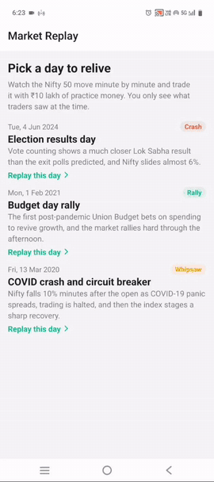

# Market Replay

Relive famous days on the Indian stock market minute by minute, and practise trading them.

Pick a day, press play and watch the Nifty 50 move exactly as it did, at up to 300× speed. Buy, sell short and set stop-losses with ₹10 lakh of practice money. When the market closes you see how you did against simply buying at the open and holding.

Built with React Native (Expo SDK 58, TypeScript), Skia, Reanimated and Gesture Handler.

**[Download the Android APK](https://github.com/architaagr25/Market_Replay/releases/latest/download/market_replay.apk)** · [Full demo video](https://github.com/architaagr25/Market_Replay/releases/latest/download/demo.mp4)

<p align="center">
  
</p>

<p align="center"><sub>Replaying 13 March 2020. The recording is sped up 3×.</sub></p>

## Days included

| Day             | What happened                                                                                                                               |
| --------------- | ------------------------------------------------------------------------------------------------------------------------------------------- |
| **13 Mar 2020** | COVID crash. Nifty falls 10% minutes after the open, trading is halted by the circuit breaker, then the index rallies hard once it resumes. |
| **1 Feb 2021**  | Union Budget. A flat morning, then a rally of almost 5% through the afternoon.                                                              |
| **4 Jun 2024**  | General election results. Nifty slides almost 6% as counting shows a much closer result than the exit polls predicted.                      |

## Features

- Candlestick chart drawn with Skia: auto-scrolling, price and time axes, a live price tag, and a long-press crosshair with the candle's open, high, low and close.
- Play, pause, 1× / 10× / 60× / 300× speed, and a scrubber to jump anywhere in the session.
- Paper trading: market orders, short selling, stop-losses and ₹20 brokerage per order. Buy and sell markers on the chart, with outlined markers for stop-loss exits.
- Detects the trading halt on 13 March 2020 from the prices alone, shows a banner, and blocks orders until trading resumes.
- Pop-ups for big moves ("Nifty down 6% on the day"), gap openings and a little news context for each day.
- End-of-day results: P&L, win rate, best and worst trade, and a comparison with buy and hold.
- Dark mode, haptic feedback, and screen-reader labels on the controls.

## How it works

Everything that decides what the market looked like, or what a trade did, is plain TypeScript in [`src/engine`](src/engine) with no React Native imports. The UI reads from it; it never works anything out itself.

| Problem                                                 | Approach                                                                                                                                                                                                                                                                                               | Code                                                                                                                |
| ------------------------------------------------------- | ------------------------------------------------------------------------------------------------------------------------------------------------------------------------------------------------------------------------------------------------------------------------------------------------------ | ------------------------------------------------------------------------------------------------------------------- |
| Replay time runs at its own speed and can pause or jump | A virtual clock that only moves when it's told how much real time has passed. It never reads the system clock, which makes it deterministic and easy to test.                                                                                                                                          | [`replayClock.ts`](src/engine/replayClock.ts)                                                                       |
| The chart must never show the future                    | What's on screen is a pure function of the day and the replay time. Candles are found by binary search, and the candle still forming only includes the part of its minute that has happened. Jumping to 14:00 gives exactly the same chart as playing until 14:00.                                     | [`candleBuilder.ts`](src/engine/candleBuilder.ts)                                                                   |
| Candles should form smoothly, not jump once a minute    | The data only has open, high, low and close per minute, so each minute follows a path through them: a green candle dips to its low before reaching its high, a red one the other way round.                                                                                                            | [`pricePath.ts`](src/engine/pricePath.ts)                                                                           |
| At 300× one frame covers several minutes                | Stop-losses and milestones walk every turning point between two frames instead of sampling the price once per frame, so a spike in between is never skipped. If price jumps past a stop (say, when trading resumes after a halt) it fills at the first available price, like a real stop order.        | [`pricePath.ts`](src/engine/pricePath.ts)                                                                           |
| The dataset has no halt flag                            | Five or more minutes of perfectly flat candles count as a halt. Flat stretches close together are merged with the pre-open session between them, where prices move but nothing trades, so stops and milestones ignore those prices too.                                                                | [`halts.ts`](src/engine/halts.ts)                                                                                   |
| Long and short positions, partial closes and flips      | Immutable account updates with signed positions. Orders that grow a position are limited by buying power; orders that shrink it are always allowed, so a losing trade can always be closed.                                                                                                            | [`paperBroker.ts`](src/engine/paperBroker.ts)                                                                       |
| Smooth rendering while the replay runs                  | One requestAnimationFrame loop updates the clock, checks stops and sets state in the same callback, so React renders at most once per frame. All green candles go into one Skia path and all red ones into another, so the chart draws a handful of shapes per frame however many candles are visible. | [`useReplay.ts`](src/hooks/useReplay.ts), [`CandleChart.tsx`](src/components/chart/CandleChart.tsx)                 |
| Gestures shouldn't wait on JavaScript                   | The crosshair and the scrubber thumb move on the UI thread with Reanimated shared values. React only hears about it when the finger moves onto a different candle or minute.                                                                                                                           | [`CandleChart.tsx`](src/components/chart/CandleChart.tsx), [`TimeSlider.tsx`](src/components/replay/TimeSlider.tsx) |

A few behaviours worth knowing about:

- **Rewinding after trading isn't allowed.** It would leave you holding a position you haven't bought yet. Jumping forward is fine, and anything that would have happened on the way, like a stop being hit, still happens. Reset to start over.
- **The replay pauses when the app goes to the background**, and stays paused when you come back.
- **The bundled data is validated on load**: sorted, unique, minute-aligned, inside market hours and internally consistent. A bad file fails loudly instead of producing a subtly wrong replay.

## Running it

The quickest way to try it is the [APK](https://github.com/architaagr25/Market_Replay/releases/latest/download/market_replay.apk) (Android). To run it from source you need Node 20 or newer. All native modules used are included in Expo Go, so no native build is needed.

```bash
npm install
npx expo start
```

Then scan the QR code with Expo Go on an Android or iOS phone.

```bash
npm test            # 208 tests across 22 suites
npm run typecheck
npm run lint
```

## Tests

The engine is tested against the claims above, not just the happy path. A few examples:

- Every 7 seconds through all three real days, no candle on screen contains data from after the replay time.
- Jumping to a time and playing to it give identical results, even with uneven frame times.
- Price ranges between two frames match brute-force sampling of the price every second.
- A stop-loss hit during a two-minute frame fills at the right price, and one gapped over by the reopening after a halt fills at the reopening price.
- The halt detector finds exactly 09:22 to 10:21 on 13 March 2020, and nothing on the other days.
- The "Max" quantity button never suggests an order the broker would reject.
- The replay hook renders at most once per animation frame.

## Data

Minute data for the Nifty 50 index comes from the [NIFTY 50 minute data](https://www.kaggle.com/datasets/debashis74017/nifty-50-minute-data) dataset on Kaggle by **debashis74017**, released under **CC0: Public Domain**. [`scripts/extract-days.mjs`](scripts/extract-days.mjs) streams the full CSV (about a million rows) and writes each chosen day as a small JSON file in [`src/data/days`](src/data/days):

```bash
npm run extract-days -- "<path to NIFTY 50_minute.csv>" 2024-06-04
```

The prices are real. The path a price takes inside a single minute is modelled, as described above.

## Limitations

- Index only, three days. Adding a day is one script run and one catalogue entry.
- Market orders only, filled at the replay price with no slippage. Brokerage is a flat ₹20 per order; taxes and exchange charges aren't modelled.
- The order of the high and low within a minute is assumed, so a stop very close to both could fill differently from how it would have in reality.
- Results are kept in memory, so they're gone after the app restarts.

## Licence

MIT. See [LICENSE](LICENSE).
